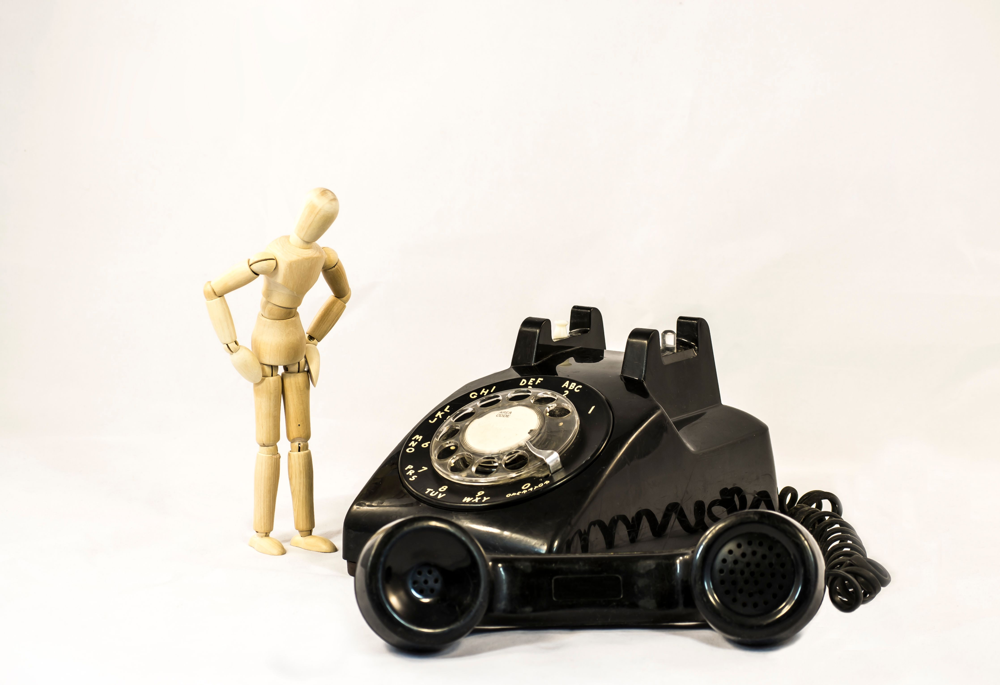

<figure>
    
    <figcaption>Image public domain - Pexels</figcaption>
</figure>

"Why should we make our front door wheelchair accessible? We never have wheelchair users coming to shop here."

The step at the door might have something to do with that. The shopkeeper is using our absence to justify keeping the step that keeps us out.

Phone-only customer support has a step, too. It's harder to see from inside the building.

Deciding how to support disabled customers without asking us is a good way to exclude us.

## The exit survey

A client told me recently that they used the results of an exit survey to decide that phone support was better for their customers. The survey was inaccessible to some disabled customers.

There are several ways an exit survey can shut people out. On the phone, a customer may have to listen to the questions and press a number before the prompt times out. If the agent reads out a web address at the end of the call, the customer has to get it down and type it in. There may still be tiny text or a CAPTCHA to get past before they even reach the questions.

The customers who couldn't use the phone never saw the survey. Those are the people who would have said "the phone doesn't work for me." The survey could tell the client how phone support worked for the people who got through and could answer. That's the group the client measured when they decided the phone was better for their customers.

What are you measuring when you say the phone is better? A customer who hangs up because the agent can't understand them can bring down the average call time without getting any help. Someone who sees only phone options on the website and gives up never makes it into the call statistics at all.

Some disabled customers just give up. Getting help can take more time and effort than they have. Some get someone else to call, and you may never know they couldn't make the call themselves. And if the only way to complain about phone support is to call, I wouldn't expect much of a complaints file.

## How many spoons does a phone call take?

Christine Miserandino used a handful of spoons to explain to a friend what it was like to live with lupus. The spoons stood for the energy she had to get through the day. Getting dressed, making breakfast, going to work all cost her spoons. Spend them on one thing and you have fewer left for everything else. She tells the story in [The Spoon Theory](https://butyoudontlooksick.com/articles/written-by-christine/the-spoon-theory/).

A call can take more spoons than many of us have left. Getting through the menu, waiting on hold, and explaining the problem to one person only to explain it again after a transfer all take energy. With email, I can write a few lines, take a break, and finish later. Try doing that when somebody finally picks up.

And then they ask you to stay on the line to answer a survey. That's the cherry on top of the icing on the cake you can't eat.

## Customers who may prefer written support

- Deaf and hard of hearing people who have trouble following phone audio, including some who use hearing aids or cochlear implants.
- Deafblind people who read email on a braille display.
- People who stutter, have dysarthria, apraxia, or aphasia, have had a laryngectomy, or use a communication device.
- People whose voices are hard to hear or get weaker as they talk, including some people with Parkinson's, MS, or respiratory conditions.
- People with auditory processing disorder who need more time to make sense of what they've heard.
- Autistic people who find unscripted calls, background noise, or having to answer on the spot difficult.
- People with ADHD who lose track of what they meant to ask while they're on hold.
- People with anxiety disorders or PTSD who find live calls hard to get through.
- People with brain injuries, brain fog, intellectual disabilities, or memory difficulties who need time to read an answer or a copy they can refer to later.
- People with chronic pain, ME/CFS, or other conditions that limit their energy. With email, they can reply when they're able.
- People who have trouble holding a phone or pressing a key before the menu starts over.
- People who want to go over the exchange with a support person, caregiver, or interpreter.

## "But we support relay services"

In a text relay call, an operator reads the caller's typed messages aloud to the person on the phone and types back what that person says. In video relay, the caller signs to an interpreter over video. The interpreter speaks to the person on the phone and signs their replies back to the caller.

Some Deaf customers choose video relay because they can use their first language. Others may prefer live chat.

Relay is an incredibly tedious process, at best. Both people have to wait for the operator or interpreter to pass along what the other person said. The customer may have to share information they'd rather give directly to the company. And some customers can't use relay at all.

If I can explain a billing error in an email, why should I have to get a third person on the phone to explain it to you?

## Customers who may prefer the phone

Some people with dyslexia, limited literacy, or hand or arm impairments find speaking easier than writing. Many blind and low vision people use the phone well. A call can still be a problem if the agent wants someone to read an account number from a printed bill or gives them instructions they'll need to refer to later.

Two customers with the same disability can prefer different ways to get help. One might call. The other might write.

## Give us another way in

Keep the phone and give customers at least one other way to reach someone who can sort out the problem. An email address that replies "please call us" is just a slower way to get to the phone number. Having to click and follow links two or three levels deep to discover an email address is pretty sub optimal as well.

I'm told a call is more personal and gets things sorted faster. It doesn't feel particularly personal when an agent asks a customer to repeat the same thing several times, then asks them to find someone else to call. I can send you a screenshot of an error message in less time than it takes me to get through the phone menu. And if you promise me a refund, I'd like the amount and the date in writing. Especially if I have to ask you for it again next month.

If email costs more to staff, say so. The customer who has to find someone else to make a call is spending time on it, too.

Ask disabled customers how we want to reach you before you decide which support options to offer. We can also try those options while you still have time to change them.

Put an accessible survey on each support channel. Count calls that end before anyone picks up, and have agents record calls that end without the customer getting help. For people who never called, put a feedback link next to the phone number so they can tell you what happened while they're still on the page. Ask disability organizations to share the link with people who may have given up on reaching you.

The step at the front door is still there, whether or not anyone is standing in front of it.