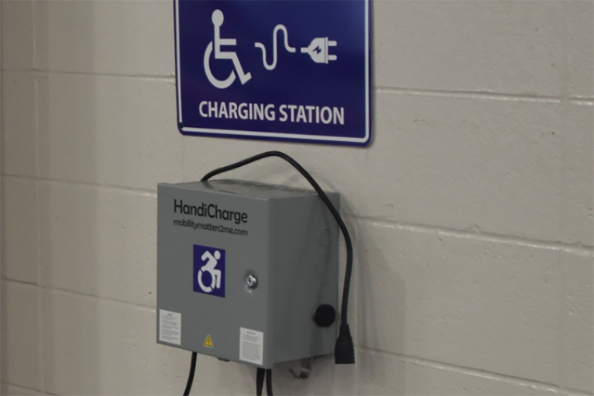

My friend Margaret had polio as a child. She used a power wheelchair with a ventilator. Electricity was essential to her daily life, including her ability to breathe.

<figure>
    
    <figcaption>A public power charging station.</figcaption>
</figure>

I've been thinking about Margaret while looking at the environmental impact of artificial intelligence. AI data centres consume increasing amounts of electricity, and meeting that demand requires infrastructure that comes with environmental and financial costs.

For someone like Margaret, a prolonged power outage could become life-threatening when backup batteries run out. Extreme heat would make the situation more dangerous.

Disabled people already face greater risks from climate change. The [United Nations Environment Programme](https://www.unep.org/en/news-and-stories/story/how-climate-change-disproportionately-impacts-those-disabilities) has documented how health conditions, inaccessible emergency planning and limited resources increase those risks.

We already know what happens when essential services fail disabled people. We also have evidence of the additional demands AI places on those services. The risks become greater when those pressures meet, even though the available evidence doesn't establish that AI has caused a particular disaster affecting disabled people.

## Electricity, heat and survival

According to the [International Energy Agency](https://www.iea.org/reports/key-questions-on-energy-and-ai/executive-summary), data centres consumed 485 terawatt-hours of electricity in 2025. To put it in perspective, 485 terawatt-hours is more electricity than the entire united Kingdom consumes in a year. That figure is projected to reach 950 terawatt-hours by 2030, with consumption by AI-focused data centres expected to triple.

Meeting that demand requires investment in electricity generation and distribution.

In November 2025, Virginia's State Corporation Commission [approved a separate electricity rate class](https://www.scc.virginia.gov/about-the-scc/newsreleases/release/scc-issues-order-on-dev-biennial-review-2025/scc-rules-in-dev-biennial-review-case.html) for customers requiring 25 megawatts or more, including data centres. Beginning in January 2027, these customers will pay separate rates and face minimum charges intended to limit cost shifting to other customers.

For disabled people living on fixed incomes, electricity costs are already difficult to manage. Air conditioning can be medically necessary for someone with multiple sclerosis or a spinal cord injury that affects temperature regulation. Electricity also powers oxygen concentrators and equipment used for daily living.

A prolonged outage can leave someone unable to charge their wheelchair or operate a ceiling hoist. Someone living in an apartment building may be unable to leave when the elevator stops working.

Extreme heat is already deadly for people with chronic health conditions, including those who remain in their own homes.

During the 2021 heat dome in British Columbia, [619 people died from heat-related causes](https://www2.gov.bc.ca/assets/gov/birth-adoption-death-marriage-and-divorce/deaths/coroners-service/death-review-panel/extreme_heat_death_review_panel_report.pdf). The BC Coroners Service found that 98% of deaths occurred indoors. Many of those who died had chronic health conditions, and more than half lived alone.

## Air pollution and water consumption

Data centres consume water for cooling. In The Dalles, Oregon, Google's data centre accounted for 29% of the city's water consumption in 2021, according to the [Oregon Department of Energy](https://www.oregon.gov/energy/Data-and-Reports/Documents/2024-BER-E101.pdf).

That's a significant share of one community's water supply. It raises questions about how future data centre development will affect water availability, especially in places already experiencing shortages.

The Dalles figures don't establish that residents experienced water shortages or restrictions. Disabled people who depend on water for home dialysis or personal care could face serious problems. Growing industrial demand could threaten their water supply.

A [2026 Virginia Commonwealth University study](https://news.vcu.edu/article/northern-virginia-data-center-air-pollution-rivals-power-plant-emissions) examined diesel generator emissions from data centres in Northern Virginia. Between 2015 and 2023, reported particulate matter emissions increased by 139%, while nitrogen oxide emissions rose by 111%.

These generators contribute a relatively small share of regional pollution. For someone with COPD or severe asthma, however, additional particulate pollution presents a health risk.

## Getting to safety

Emergency planning has repeatedly failed disabled people during disasters.

The [United Nations Flagship Report on Disability and Development](https://social.desa.un.org/sites/default/files/2025-09/DDR2024-Full-Report-Final.pdf) reports that 39% of disabled people surveyed worldwide would have great difficulty evacuating or could not evacuate during a sudden disaster. Another 28% needed evacuation assistance but had nobody available to provide it.

During Hurricane Katrina in 2005, Benilda Caixetta, a wheelchair user in New Orleans, repeatedly called for paratransit transportation to evacuate to the Superdome. The vehicle never arrived. Disability advocate Marcie Roth was speaking with her by telephone when floodwater entered her apartment. Benilda drowned.

Selena, a quadriplegic woman from Alabama, managed to evacuate but ended up in an overcrowded shelter where she slept in her wheelchair. She was later moved to accommodation without an accessible bathroom. She developed a life-threatening pressure sore and was transferred to a nursing home.

Both accounts were documented in [testimony presented at a congressional briefing on emergency management and disabled people](https://www.ncd.gov/testimonies/2005-11-10-emergency-management-and-people-with-disabilities-before-during-and-after-congressional-briefing/).

In Japan, the 2011 earthquake and tsunami had a disproportionate impact on disabled people. Mortality among disabled people in the three most affected prefectures was 2.06%, compared with 1.03% for the overall population. Those figures were [presented to the United Nations](https://www.un.org/disabilities/documents/desa/hiruma-presentation.pdf).

For disabled people who survive a disaster, returning home can present further problems. Accessibility modifications may have been destroyed. Replacing a custom wheelchair can take months, and finding another affordable, accessible home can be difficult.

## Who benefits from AI?

AI offers useful accessibility tools. Automatic captions and image descriptions can help disabled people access information, although their accuracy and reliability vary.

I've also encountered AI interfaces with unlabelled controls and keyboard accessibility failures. Companies continue releasing products that some disabled people cannot use independently.

AI companies are also increasing demand for electricity and water through their data centres. Disabled people living in affected communities share the environmental costs regardless of whether they can use the products.

## COP31 and accessibility

The [United Nations climate conference, COP31](https://unfccc.int/cop31), opened in Antalya, Türkiye, on November 9, 2026. Governments are meeting to negotiate climate policy and responses to environmental risks. There is at least one session around this topic. The Confederation of Persons with Disabilities is running “Climate Action That Leaves No One Behind: Accessible and Inclusive COP Processes from a Disability Perspective.”

[Daffyd Hughes](https://bsky.app/profile/dafydd61.bsky.social) pointed out today that the [COP31 website](https://cop31.tr/) uses an accessibility overlay. 

The [Overlay Fact Sheet](https://overlayfactsheet.com/en/), supported by accessibility practitioners and disabled people, explains why these products are problematic. Automated overlays cannot reliably repair missing form labels, keyboard accessibility problems or focus management. They can also introduce unexpected changes that interfere with screen readers.

Disabled people need access to the information coming out of COP31 and opportunities to participate in the discussions.

There is a certain level of irony at COP31 using an overlay to "fix" accessibility when they have the resources to build something accessible from the get go. The presence of an overlay raises questions about how the organizers have approached digital accessibility.

## Margaret

Margaret's ability to breathe depended on electricity supplied through infrastructure she had little control over. Decisions about how that infrastructure is developed, maintained and protected need to include disabled people whose lives depend on it.