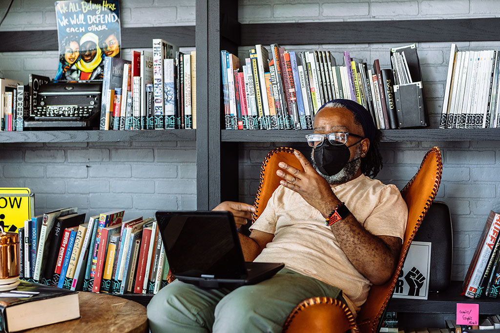

A few days ago, I saw a LinkedIn post from a design teacher who had students wear blindfolds and use screen readers to experience what it might be like to be blind.

I'm sure the teacher meant well. Disability simulations often come from good intentions, which may explain why they keep happening despite years of criticism from disabled people.

<figure>
    
    <figcaption>Photo by Gritchelle Fallesgon, <a href="https://affecttheverb.com/disabledandhere">Disabled and Here</figcaption>
</figure>

In January 2013, I wrote [Disability Simulations, Perceptions, etc](https://incl.ca/disability-simulations-perceptions-etc/). It started with David Ball, who had spent a week using his computer while blindfolded. He learned some things about screen readers and web accessibility, but I questioned what he had learned about blindness.

Thirteen years later, my position hasn't changed. Disability simulations are harmful, and we should stop using them.

## What we've learned since 2013

One of my concerns back then was that people taking part in simulations hadn't developed the skills disabled people use every day. Someone who suddenly puts on a blindfold will struggle with things that an experienced blind person can do without much thought.

In 2015, Arielle Silverman, Jason Gwinn and Leaf Van Boven published [Stumbling in Their Shoes](https://doi.org/10.1177/1948550614559650). Their experiments found that people who experienced a challenging blindness simulation subsequently judged blind people as less capable of working and living independently.

Someone struggles because they don't know how to do something without sight, and they come away thinking blind people are less capable.

I was also concerned about pity and the exaggerated admiration disabled people sometimes receive for doing ordinary things. Both reflect low expectations of what we can accomplish.

In 2017, Michelle Nario-Redmond and colleagues published [Crip for a Day](https://doi.org/10.1037/rep0000127). Participants reported more confusion, embarrassment and helplessness after simulations. Their feelings of empathy increased, but their attitudes toward interacting with disabled people didn't improve. In one experiment, pity and discomfort about interaction increased.

Participants also know the exercise will end. They can remove the blindfold whenever they want. Arielle Silverman discussed this in [The Perils of Playing Blind](https://nfb.org/images/nfb/publications/jbir/jbir15/jbir050201.html). A sudden loss of sight tells us little about the experience of someone who has been blind for years.

A [2022 meta-analysis by Gloria Ma and Winnie Mak](https://doi.org/10.1371/journal.pone.0269357) examined twelve studies of mobility disability simulations. It found a large increase in fear and anxiety, although that finding came from only two studies. There were some small improvements in attitudes, but the evidence that participants became more likely to take action to improve inclusion was inconclusive.

I want accessibility training to result in changes to how people work and the decisions they make. Someone can leave a disability simulation feeling more empathetic and continue designing inaccessible products.

Virtual reality has given simulations a new format. In a [2025 paper, Yesica Duarte and Puneet Jain](https://arxiv.org/abs/2507.15481) challenged the idea of VR as an empathy machine, questioning how these experiences can reduce disability to pity or inspiration.

## What happens in a design classroom?

The LinkedIn post that prompted this article involved students using screen readers while blindfolded.

I want designers and developers to learn how screen readers work. They need to understand how someone navigates a page by headings, for example, and what happens when a form control has no accessible name.

But screen readers take time to learn. Someone unfamiliar with the software may struggle to navigate a perfectly accessible page. They might report an accessibility defect where none exists because they don't understand the commands or expected behaviour.

They might also miss a real defect.

The same concern applies when people with little experience of assistive technology conduct accessibility testing.

A blind person who uses a screen reader every day has developed ways of working that a novice hasn't. They know what to expect from an accessible interface and can recognize when something interferes with their work.

I can teach someone how to operate a screen reader and how to identify common technical failures. That doesn't make them an experienced blind user.

Research published online in 2022 by Anthony Maher and Justin Haegele examined [the authenticity of disability simulations](https://doi.org/10.1080/00131911.2022.2119207) through interviews with nine visually impaired adults. Their findings challenged the idea that a short exercise could represent the varied experiences of people living with visual impairments.

The participants described how simulations missed the skills and experience people develop over time. Yet the nondisabled participant's hour gets more attention than a disabled person's decades of experience.

## We already have better approaches

For the design students, I'd invite an experienced blind screen reader user to demonstrate how they navigate websites. Let them show what happens when a form has missing labels and how that affects their ability to complete a task. Students can learn how to use the technology themselves and apply that knowledge to their designs.

In 2022, Emily Hicks, Meg Traci and Karin Korb [compared disability simulations with inclusive accessibility audits](https://doi.org/10.3389/fresc.2022.876099) in rural communities. Participants described simulations as embarrassing and uncomfortable, sometimes increasing fear and reinforcing stigma, while audits involving disabled people were associated with actual improvements to public spaces. The researchers recommended discontinuing simulations in favour of approaches that involve disabled people in identifying barriers.

Someone demonstrating how they use a screen reader is sharing expertise, not doing an organization a favour.

Pay disabled people for their time.

## What I'd say today

If someone asked me to help organize a disability simulation, I'd decline.

I'd ask what they wanted participants to do differently afterward, whether disabled people had been involved in planning the training, and why they weren't inviting those people to teach instead.

In 2013, I argued that disability education needed to happen together with disabled people. I still believe that.